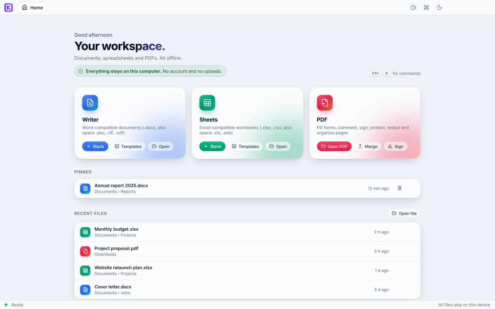
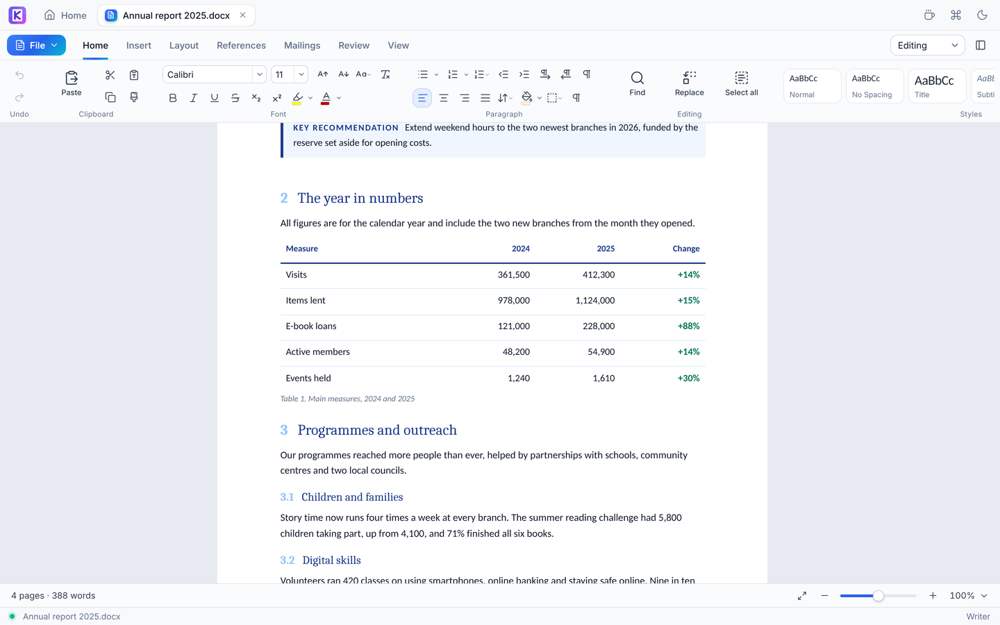
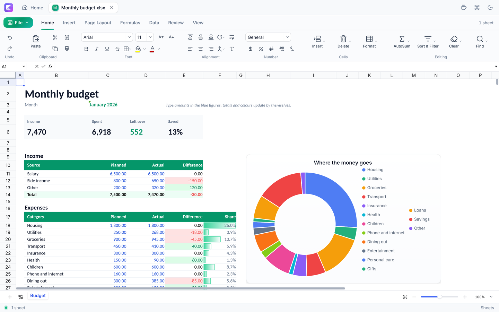
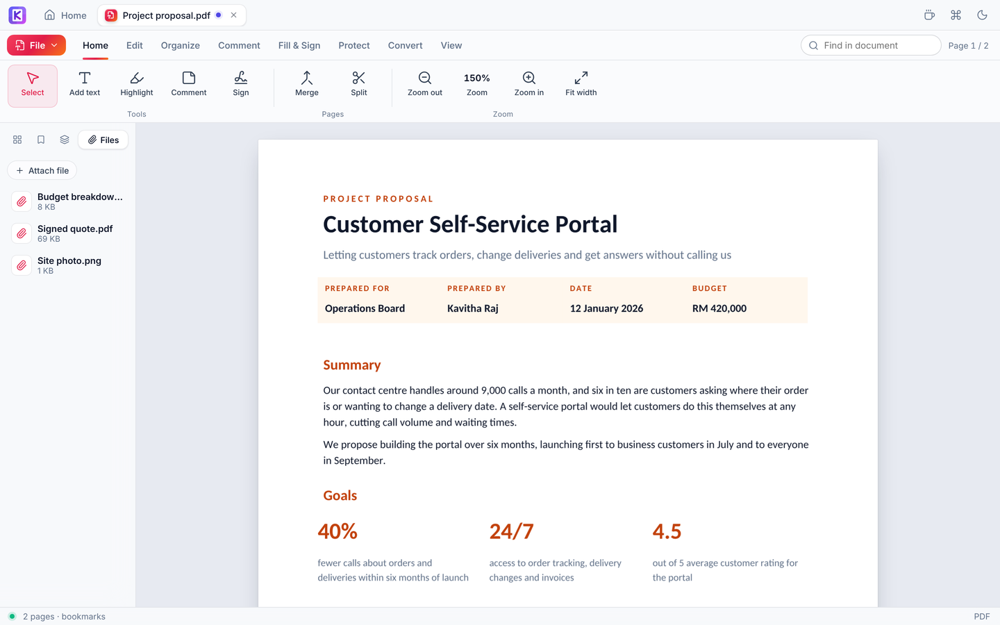
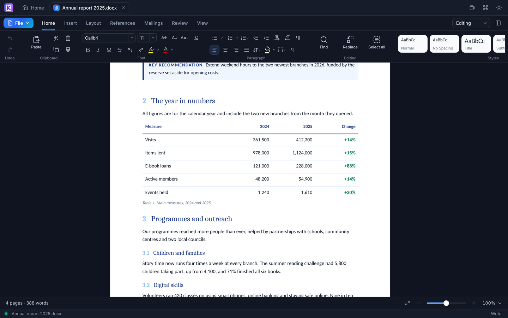

# Kertas Office

**A free, open-source office suite for Windows, macOS and Linux.** Write documents, work with spreadsheets and edit PDFs in one app, with files that open cleanly in your favourite document apps.

No account, no subscription, no ads. Everything runs on your computer and your files never leave it.

[kertasoffice.com](https://kertasoffice.com) · [Download](https://kertasoffice.com/download) · [Compatibility](https://kertasoffice.com/compatibility) · [Help](https://kertasoffice.com/help)

## Three apps in one window

Every file opens in its own tab, so a report, the spreadsheet behind it and a signed PDF sit side by side.

### Writer: documents

Opens and saves Word documents (.docx), and opens .doc, .rtf and .odt.

- A familiar ribbon: fonts, colours, styles, lists, alignment, spacing, borders and shading, with live previews
- A right-click menu with a formatting bar, and Font, Paragraph and Tabs dialogs
- Bullet and number libraries, custom numbering and multilevel lists
- Tables with ready-made designs, header and banded rows, sorting, merging and moving rows and columns, plus borders, shading, row height, cell margins and cell alignment
- Pictures you can drag in, rotate, flip, crop, caption and link
- Form fields: text, tick box, dropdown list and date picker, saved as Word content controls
- Headers and footers (with different first, odd and even pages), page numbers, columns, margins, paper sizes, watermarks, page borders, line numbers
- Table of contents, footnotes and endnotes, captions, citations and bibliography (APA, MLA, Chicago, Harvard, IEEE)
- Equations typed in LaTeX and saved as real Word equations
- Comments, track changes with accept and reject, and protection for read-only or comment-only documents
- Mail merge from an Excel or CSV list
- Spell check in English, French, Spanish and German
- Type **/** anywhere for a quick menu of commands
- Eight ready-made templates: resume, cover letter, business letter, invoice, meeting minutes, report, project proposal and memo

### Sheets: spreadsheets

Opens and saves Excel workbooks (.xlsx) and CSV, and opens .xls, .xlsm, .xlsb and .ods.

- Hundreds of formulas, AutoSum and a function browser
- Charts (column, bar, line, area, pie, doughnut, scatter) that update as the numbers change
- PivotTables with several row, column and value fields, saved as real Excel PivotTables
- Conditional formatting: highlight rules, top and bottom, data bars, colour scales and icon sets
- Sort and filter, slicers, data validation and drop-down lists, remove duplicates, text to columns
- Threaded comments with replies and resolve, and named ranges
- Sparklines, grouped rows and columns, freeze and split panes, cell styles, format as table, protected ranges
- Eight ready-made templates: monthly budget, invoice, expense tracker, project timeline, sales tracker, timesheet, inventory and loan calculator

### PDF: view, edit and sign

- Fill in forms, or make your own with text fields, check boxes, choice buttons, drop-down lists and list boxes
- Add comments, highlights, stamps, shapes and drawings
- Pictures, text and shapes stay movable and resizable until you save
- Layers: see and edit the layers of PDFs made in other apps, add your own, show, hide, rename and move them
- Edit the existing text of a PDF
- Sign with a drawn signature or a digital certificate (.p12 / .pfx)
- Merge, split, extract, reorder, rotate and delete pages; turn images into a PDF
- Attach files to a PDF, and open or save the files attached to it
- Compress PDFs to a fraction of their size
- Password protection with permissions, true redaction, watermarks, headers, footers and page numbers
- Convert to Word, Excel or images, and make scanned pages searchable with built-in text recognition (OCR)

### And more

- Light and dark themes
- Export any document to PDF and print
- Unsaved work is recovered after a crash
- Updates install themselves in the background (you can switch this off)
- Text supports multi-languages including RTL scripts

## Download

Get the latest version from the [Releases page](../../releases/latest):

| System | File |
|---|---|
| Windows 10 and 11 (Intel, AMD and ARM) | `Kertas-Office-Setup.exe` |
| macOS 12 or later (Apple silicon) | `Kertas-Office-mac-arm64.dmg` |
| macOS 12 or later (Intel) | `Kertas-Office-mac-x64.dmg` |
| Linux (any distribution) | `Kertas-Office-linux-x86_64.AppImage` |
| Ubuntu and Debian | `kertas-office-amd64.deb` |

Opening older .doc and .xls files with full formatting works best when [LibreOffice](https://www.libreoffice.org) is also installed; without it, their text and data still open.

## Built with

Kertas Office stands on excellent open-source projects:

- [SuperDoc](https://github.com/superdoc-dev/superdoc) for Word documents
- [Univer](https://github.com/dream-num/univer) for spreadsheets, with [ExcelJS](https://github.com/exceljs/exceljs) and [SheetJS](https://sheetjs.com) for Excel files
- [PDF.js](https://mozilla.github.io/pdf.js/) and [pdf-lib](https://pdf-lib.js.org) for PDFs, [Tesseract.js](https://tesseract.projectnaptha.com) for text recognition
- [Electron](https://www.electronjs.org) for the desktop app, [Lucide](https://lucide.dev) for icons

## Contributing

Kertas started as a solo project and is now developed in the open by its community. Bug reports, ideas and pull requests are welcome; files that do not open correctly are especially helpful. Questions go to [Discussions](https://github.com/kertas-office/kertas-office/discussions), and security problems should be [reported privately](https://github.com/kertas-office/kertas-office/security/advisories/new).

Pull requests go to the `develop` branch; `main` only receives tested releases. Please open an issue first for larger changes, run `npm test` before sending a pull request (and `npm run e2e` for changes to how the apps behave; on Linux run it under `xvfb-run -a`), and keep the interface wording plain and friendly.

## License

Kertas Office is free software under the [GNU Affero General Public License v3.0](LICENSE) or later. You may use, share, change and sell it; if you give copies to others, give them the source code too, including your changes.

The bundled components keep their own licences: SuperDoc (AGPL-3.0), Univer, PDF.js and Tesseract.js (Apache-2.0), ExcelJS, SheetJS Community Edition, pdf-lib and most other libraries (MIT), node-forge (BSD-3-Clause) and Lucide icons (ISC). The built-in fonts use the SIL Open Font License. Spell-check dictionaries: English (MIT / BSD), French (MPL-2.0), Spanish (GPL-3.0 / LGPL-3.0 / MPL-1.1), German (GPL-2.0 / GPL-3.0).

## Support the project

Kertas Office is free and always will be. If it saves you time or money, you can [buy us a coffee](https://buymeacoffee.com/hasheee) or star the repository.

The website lives in [`website/`](website/README.md).
